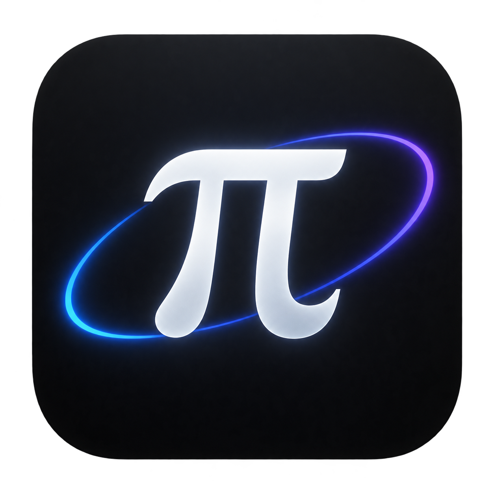
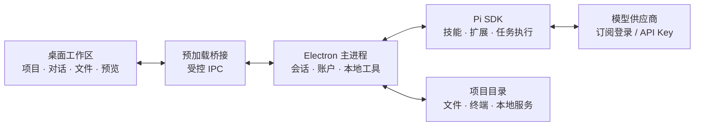

<p align="center">
  
</p>

<h1 align="center">Pi Halo · 星环</h1>

<p align="center">把 AI 对话、项目文件、实时预览和终端放在同一个桌面工作区。</p>

<p align="center">
  <a href="https://github.com/13075061852/WebPi/releases/latest">下载安装</a> ·
  <a href="docs/USAGE.md">使用指南</a> ·
  <a href="docs/DEVELOPMENT.md">开发指南</a> ·
  <a href="docs/README.md">全部文档</a>
</p>

## 星环是什么

Pi Halo 是基于 Pi agent 的桌面应用。你可以围绕本地项目与 AI 协作：描述任务、查看执行过程、打开生成的网页和文档，也可以使用终端启动项目服务。

应用通过 Pi SDK 管理会话，支持 Pi 的技能、扩展、提示模板、`AGENTS.md` 上下文、会话树、引导与追加消息，以及上下文压缩。安装版内置 Pi 内核和 Electron 的 Node 运行时，无需先安装全局 Pi。

## 能做什么

### 从对话到项目交付

- **项目与文件**：按项目管理对话和工作目录，从文件树添加任务附件、查看文件与改动。
- **任务过程**：流式显示回复、思考与工具调用，查看任务状态、耗时及用量。
- **并发会话**：切换到其他对话继续工作，已启动的任务在后台运行。

### 在应用内查看结果

- **网页预览**：查看本地页面，使用普通视图或设备外壳检查效果；支持启动并预览本地项目。
- **文件预览**：查看图片、视频、Markdown、PDF 与现代 Office 文件。PDF 支持连续滚动、选择和复制文字。
- **项目终端**：多标签与平铺终端，支持命令历史、补全、复制粘贴和中断。

### 使用自己的模型与工具

- **模型与账户**：配置订阅登录或 API Key，保存多个身份并切换账户，查看可获取的额度信息。
- **办公文档**：内置 Word、Excel、PowerPoint、PDF 技能，生成、检查并预览本地文件。
- **媒体任务**：配置图像、视频和数字人服务；模型范围与参数见对应文档。
- **主题外观**：提供明暗外观、液态玻璃与主题图片。

## 开始使用

### 安装版

1. 从 [GitHub Releases](https://github.com/13075061852/WebPi/releases/latest) 下载 Windows x64 安装器。
2. 安装并打开应用，在设置中完成模型登录或 API Key 配置。
3. 添加项目文件夹，新建对话并描述要完成的任务。

普通对话不需要预装全局 Pi 或 Node。任务需要 Python、Git 等外部工具时，可在「设置 → 环境配置」中检测并配置，见 [环境配置说明](docs/ENVIRONMENT-SETUP.md)。

安装版自动检查并后台下载更新，下载完成后由你点击「重启更新」安装。具体行为见 [软件更新说明](docs/app-updates.md)。

### 从源码运行

准备 Node.js ≥ 22.19.0 和 Git，在仓库目录执行：

```bash
npm ci
npm start
```

首次安装需要下载 Electron 依赖。开发、测试和构建细节见 [开发指南](docs/DEVELOPMENT.md)。

## 工作区如何连接



| 目录 | 内容 |
| --- | --- |
| [`src/main/`](src/main/) | Electron 主进程、Pi 桥接、本地工具及服务 |
| [`src/preload/`](src/preload/) | 界面与主进程之间的 API |
| [`src/renderer/`](src/renderer/) | 聊天、文件树、预览、终端和主题界面 |
| [`assets/`](assets/) | 内置技能、图标与运行资源 |
| [`test/`](test/) | 离线回归和 Electron 交互验证 |
| [`docs/`](docs/) | 使用、开发、发布与历史记录 |

## 使用范围

- **平台**：目前以 Windows x64 为主；macOS / Linux 的终端与部分系统集成尚未完整适配。
- **模型费用**：使用你配置的账户和额度。服务商的网站订阅、API 权限与余额可能不同。
- **文档兼容性**：复杂 Office 图表、动画和特殊排版可能与原软件不同；Excel 预览展示缓存结果，不负责公式重算。
- **执行权限**：本地工具可读写项目文件并执行命令，权限等同当前用户。使用任务前应确认项目目录与要求。

## 文档导航

| 想了解什么 | 文档 |
| --- | --- |
| 对话、附件、预览、终端和快捷键 | [使用指南](docs/USAGE.md) |
| 启动已有网页项目 | [本地项目启动与预览](docs/PROJECT-START.md) |
| 配置视频模型与恢复生成任务 | [视频模型](docs/video-providers.md) |
| 数字人与声音样本 | [数字人方案](docs/DIGITAL-HUMAN.md) |
| 修改代码、运行检查与测试 | [开发指南](docs/DEVELOPMENT.md) |
| 制作安装包与发布更新 | [Windows 发布流程](docs/RELEASING.md) |
| 其他专题与历史验证记录 | [全部文档](docs/README.md) |
